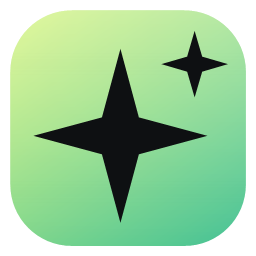
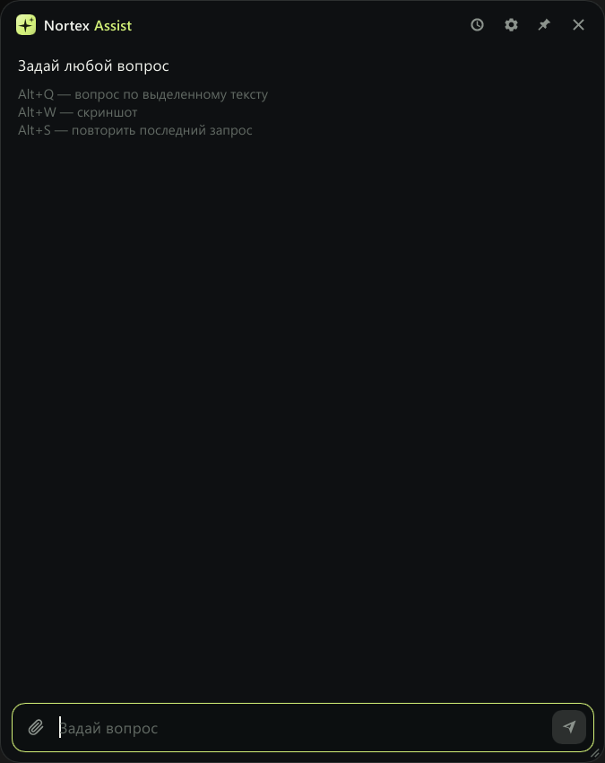
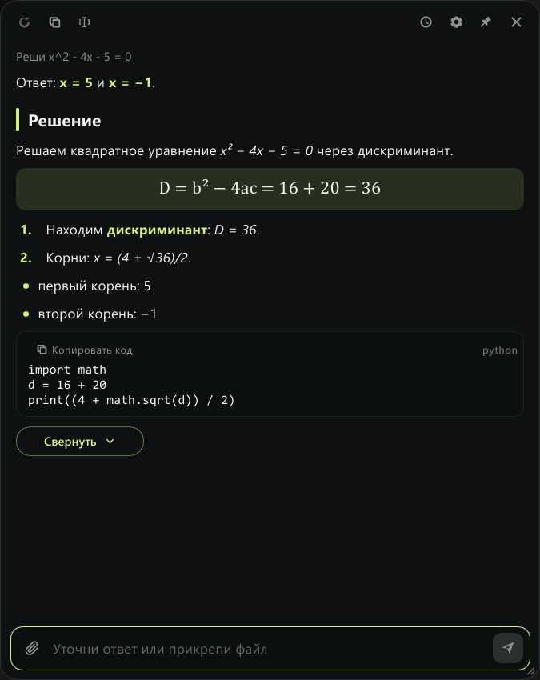

  

<h1 align="center">Nortex Assist</h1>

  A hotkey AI assistant for Windows: ask Gemini or Groq about selected text, 
  a screenshot, a file or anything you type.

  
  
  

  <a href="README.md">Русский</a> · <b>English</b>

> The interface is available in Russian and English: use the small RU | EN switch at the bottom of the settings.

  
  &nbsp;
  

## Download

Get it from [Releases](https://github.com/nortex-labs/nortex-assist/releases):

- **`NortexAssist-Setup-X.Y.Z.exe`**: the installer (recommended). No admin rights needed.
- **`nortex-assist.exe`**: the portable version. Just run it.

Both update themselves. If Windows SmartScreen warns about an unknown publisher, click "More info" → "Run anyway".

## Quick start

1. Install the app from [Releases](https://github.com/nortex-labs/nortex-assist/releases).
2. Get a free API key, one of:
   - **Gemini:** open [Google AI Studio](https://aistudio.google.com/app/apikey), sign in, click "Create API key" and copy it.
   - **Groq:** open [Groq Console](https://console.groq.com/keys), sign up, click "Create API Key" and copy it.
3. On first launch the settings open by themselves. Pick the provider, paste the key and click "Done".
4. Select some text in any app and press **Alt+Q**. The answer appears in a window at the bottom right.

## Features

- **Short answer first.** A one-line answer appears at once; the "Show more" button opens the full explanation (it can be turned off in the settings, "Answers").
- **Readable answers.** Headings, lists, quotes, formulas and code blocks, each code block with its own "Copy code" button. The "Copy" button in the toolbar copies the short answer without formatting; "Select text" turns the answer into plain text you can select with the mouse.
- **Files.** The paperclip next to the input field attaches text files to your question. A folder can be dragged into the pinned window.
- **On top of windows.** A small click-through window with a short answer that never takes focus: works over games, videos and lectures (settings, "Appearance").
- **Two languages.** The whole interface and the answers can be switched between Russian and English with the RU | EN button at the bottom of the settings. By default the answer is written in the language of the question, and in Russian when the language cannot be told.
- **Your way.** Answer style (own prompt and presets), answer text size, dark and light theme, opacity, accent colour, your own hotkeys.

## Hotkeys

You can change them in the settings.

| Keys | Action |
|------|--------|
| **Alt+Q** | Ask about the selected text |
| **Alt+W** | Screenshot: select an area, the whole screen, or the Windows Snipping Tool (set in the settings) |
| **Alt+E** | Ask your own question. Press again for a new conversation |
| **Alt+S** | Repeat the last request. If an answer already came, the model tries a different one |

Esc hides the window and stops the answer. Ctrl+V in the input field pastes an image.

## Uninstalling

Use "Settings → Apps" in Windows for the installed version, or the trash icon at the bottom of the app's settings: it asks for confirmation and the "Delete" button turns on after 5 seconds. The hidden shortcut **Alt+Shift+Delete** removes the app together with its settings, keys and history at once, without asking.

## Privacy

- API keys, settings and history stay **on your computer only**, in `%APPDATA%\NortexAssist`.
- The files are encrypted with AES-256-GCM. The encryption key is protected by Windows DPAPI.
- Questions, text and screenshots are sent **only to the provider you chose** (Google Gemini or Groq).
- The app checks GitHub for updates. You can turn this off.
- Screenshots are never saved to disk. The history keeps only questions and answers.

## License

[MIT](LICENSE) © 2026 Nortex Labs
