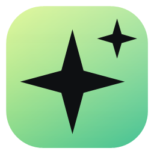
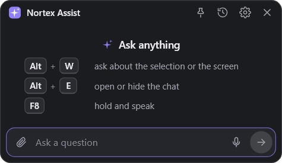
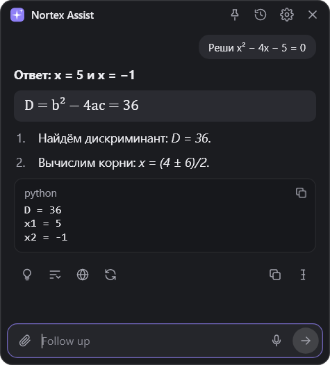
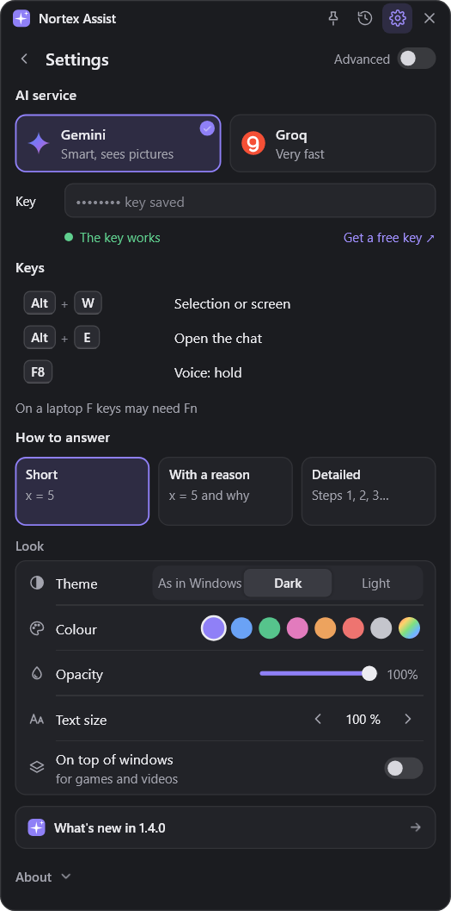

  

<h1 align="center">Nortex Assist</h1>

  A hotkey AI assistant for Windows: ask Gemini or Groq about selected text, 
  a screenshot, by voice or anything you type.

  
  
  

  <a href="README.md">Русский</a> · <b>English</b>

> The interface is in English or Russian. On first launch it follows the Windows language; switch it under Settings → About → RU | EN.

  
  &nbsp;
  

## Download

Get it from [Releases](https://github.com/nortex-labs/nortex-assist/releases):

- **`NortexAssist-Setup-X.Y.Z.exe`**: the installer (recommended). No admin rights needed.
- **`nortex-assist.exe`**: the portable version. Just run it.

Both update themselves. If Windows SmartScreen warns about an unknown publisher, click "More info" → "Run anyway".

## Quick start

1. Install the app from [Releases](https://github.com/nortex-labs/nortex-assist/releases).
2. Get a free API key, one of:
   - **Groq** (very fast): open [Groq Console](https://console.groq.com/keys), sign up, click "Create API Key" and copy it.
   - **Gemini** (smart, sees pictures): open [Google AI Studio](https://aistudio.google.com/app/apikey), sign in, click "Create API key" and copy it.
3. On first launch the settings open by themselves. Pick the AI service and paste the key into the "Key" field. Settings are saved at once.
4. Select some text in any app and press **Alt+W**. The answer appears in a window at the bottom right.

## Features

- **One key for everything.** Alt+W works out what to ask: the selected text, or, if nothing is selected, an area of the screen you circle. The answer comes at once.
- **Voice.** Hold F8, say your question, let go. With the window open the text goes into the input field; with it closed it is asked right away.
- **One-click follow-ups.** Under the answer: Explain, Shorter, Translate and Another answer. You can set your own buttons.
- **No dead end at the limit.** If Groq runs out of its limit and you also have a Gemini key, the same question goes to Gemini by itself.
- **Conversation and history.** Ask a follow-up question. The history is encrypted and can be reopened and continued.
- **Files and pictures.** The paperclip attaches text files, Ctrl+V pastes a picture. Up to 4 screenshots per question (3 with Groq).
- **On top of windows.** A small click-through window with a short answer that never takes focus: works over games, videos and lectures.
- **Your way.** Theme as in Windows, light or dark, colour, opacity, text size, your own prompt and hotkeys.

## Hotkeys

Change them in the settings: "Keys", and the rest under "Advanced" → "Keys".

| Keys | Action |
|------|--------|
| **Alt+W** | Text selected: ask about it. Nothing selected: a screenshot of an area. The answer comes at once |
| **Alt+Shift+W** | The same, but you can add a note before sending: what exactly to ask |
| **Alt+E** | Open or hide the chat. A recent conversation (up to 15 minutes) goes on |
| **F8** (hold) | Voice: speak while you hold the key |
| **Alt+S** | Repeat the last request, for example after a network error |

**Separate keys.** If you prefer the old way, choose "Advanced" → "Keys" → "Mode" → "Separate": Alt+Q asks about the selected text, Alt+W takes a screenshot, Alt+E opens the chat, Alt+S repeats, F8 is voice. Users who updated from 1.3 stay in this mode until they switch.

In the window: **Esc** hides it and stops the answer, **Enter** sends, **Shift+Enter** starts a new line, **Ctrl+V** pastes a picture, the **microphone** button records (click, speak, click again), the **pin** keeps the window open.

  

## Voice

- Hold **F8** in any app, speak and let go. A small bar with the sound level shows at the bottom of the screen.
- If text was selected when you pressed the key, what you say becomes a note to it ("translate", "explain simpler").
- **Esc** cancels. A press shorter than 0.3 s is ignored; a recording lasts at most 60 s.
- A recording without speech (silence, key clicks) is not sent anywhere.
- Speech is recognised by Whisper on Groq if you have a Groq key, otherwise by Gemini.

## Uninstalling

Use "Settings → Apps" in Windows for the installed version, or open "About" at the bottom of the app's settings → "Uninstall": it asks for confirmation and the "Delete" button turns on after 5 seconds. The hidden shortcut **Alt+Shift+Delete** removes the app together with its settings, keys and history at once, without asking.

## Privacy

- API keys, settings and history stay **on your computer only**, in `%APPDATA%\NortexAssist`.
- The files are encrypted with AES-256-GCM. The encryption key is protected by Windows DPAPI.
- Questions, text, screenshots and files are sent **only to the AI service you chose** (Google Gemini or Groq). If Groq hits its limit and you have a Gemini key, that question goes to Gemini, with a note under the answer.
- **Voice** is recorded in memory only and never saved to disk. It is sent for recognition to Groq (Whisper) if you have a Groq key, otherwise to Gemini. The log keeps only service numbers (loudness, recognition confidence), no sound and no text.
- The app checks GitHub for updates. You can turn this off under "Advanced" → "Program" → "Updates".
- Screenshots are never saved to disk. The history keeps only questions and answers.

## License

[MIT](LICENSE) © 2026 Nortex Labs
