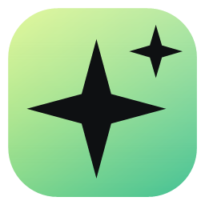
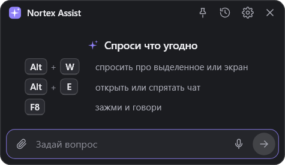
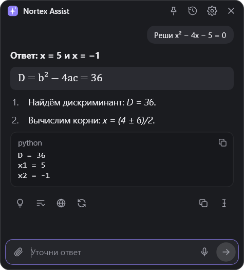
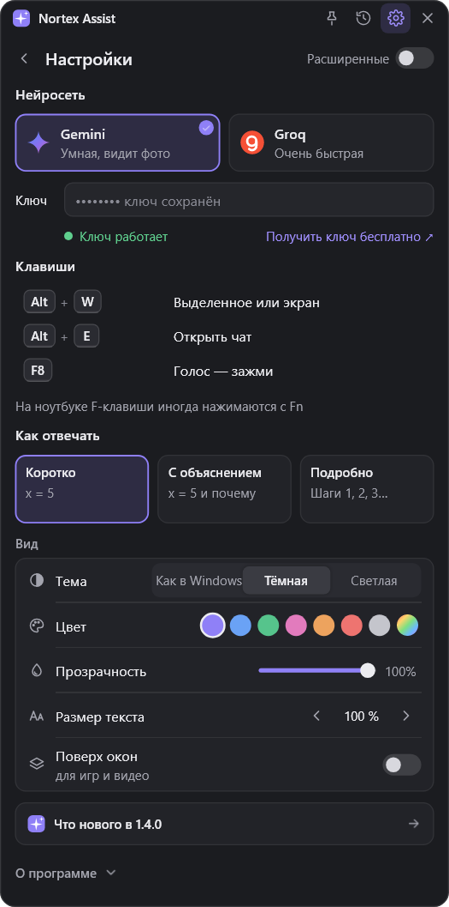
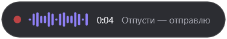
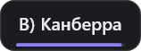

<p align="center">
  
</p>

<h1 align="center">Nortex Assist</h1>

<p align="center">
  AI-помощник по горячим клавишам для Windows: спросите Gemini или Groq<br>
  по выделенному тексту, по снимку экрана, голосом или просто своим вопросом.
</p>

<p align="center">
  <a href="https://github.com/nortex-labs/nortex-assist/releases/latest"></a>
  <a href="LICENSE"></a>
  
</p>

<p align="center">
  <b>Русский</b> · <a href="README.en.md">English</a>
</p>

<p align="center">
  
  &nbsp;
  
</p>

## Скачать

Все версии лежат на странице [Releases](https://github.com/nortex-labs/nortex-assist/releases).

- **`NortexAssist-Setup-X.Y.Z.exe`** — установщик. Рекомендуется: создаёт ярлык в меню «Пуск» и удаляется как обычная программа. Права администратора не нужны.
- **`nortex-assist.exe`** — портативная версия. Ничего не устанавливает, просто запустите.

Обе версии обновляются сами. Windows SmartScreen может предупредить о неизвестном издателе: нажмите «Подробнее» → «Выполнить в любом случае».

## Возможности

- **Одна клавиша на всё.** Alt+W сам понимает, что спросить: если выделен текст, спрашивает про него, если нет — предлагает обвести область экрана. Ответ приходит сразу.
- **Голос.** Зажмите F8, скажите вопрос и отпустите. Окно открыто — текст появится в поле ввода, закрыто — сразу уйдёт вопросом.
- **Уточнить в один клик.** Под ответом кнопки «Объясни», «Короче», «Переведи» и «Другой вариант». Свои кнопки можно настроить.
- **Не упирается в лимит.** Если у Groq кончился лимит, а у вас есть ключ Gemini, этот же вопрос сам уйдёт в Gemini.
- **Диалог и история.** Ответ можно уточнить следующим вопросом. История хранится зашифрованной, её можно открыть и продолжить.
- **Файлы и снимки.** Скрепка прикрепляет текстовые файлы, Ctrl+V вставляет картинку. В одном вопросе до 4 снимков (у Groq до 3).
- **Режим «Поверх окон».** Короткий ответ в маленьком окне, которое не забирает фокус: работает над играми, видео и лекциями.
- **Под себя.** Тема как в Windows, светлая или тёмная, цвет, прозрачность, размер текста, свой промпт, свои клавиши. Интерфейс на русском и английском.

## Быстрый старт

1. Скачайте и запустите установщик со страницы [Releases](https://github.com/nortex-labs/nortex-assist/releases).
2. Получите бесплатный ключ API. Нужен один из двух:
   - **Groq** (очень быстрая): откройте [Groq Console](https://console.groq.com/keys), зарегистрируйтесь, нажмите «Create API Key», скопируйте ключ.
   - **Gemini** (умная, видит фото): откройте [Google AI Studio](https://aistudio.google.com/app/apikey), войдите в аккаунт Google, нажмите «Create API key», скопируйте ключ.
3. При первом запуске сами откроются настройки. Выберите нейросеть и вставьте ключ в поле «Ключ». Настройки сохраняются сразу.
4. Выделите текст в любой программе и нажмите **Alt+W**. Ответ появится в окне справа внизу.

## Горячие клавиши

Клавиши меняются в настройках: раздел «Клавиши», остальные — в «Расширенные» → «Клавиши».

| Клавиши | Что делает |
|---------|------------|
| **Alt+W** | Выделен текст — вопрос по нему. Ничего не выделено — снимок области экрана. Ответ приходит сразу |
| **Alt+Shift+W** | То же, но перед отправкой можно дописать пометку: что именно спросить |
| **Alt+E** | Открыть или спрятать окно чата. Недавний диалог (до 15 минут) продолжается |
| **F8** (зажать) | Голос: говорите, пока держите клавишу |
| **Alt+S** | Повторить последний запрос, например после ошибки сети |

**Отдельные клавиши.** Если удобнее по-старому, в «Расширенные» → «Клавиши» → «Режим» выберите «Отдельные»: Alt+Q — вопрос по выделенному тексту, Alt+W — скриншот, Alt+E — чат, Alt+S — повтор, F8 — голос. Кто обновился с версии 1.3, остаётся в этом режиме, пока сам не переключится.

Способ снимка выбирается в «Расширенные» → «Скриншоты»: «Выделить область», «Весь экран» или «Ножницы Windows».

В окне программы:

- **Esc** прячет окно и останавливает ответ;
- **Enter** отправляет, **Shift+Enter** — новая строка;
- **Ctrl+V** в поле ввода вставляет картинку из буфера обмена;
- **микрофон** у поля ввода: нажмите, говорите, нажмите ещё раз;
- **скрепка** прикрепляет текстовые файлы;
- **булавка** вверху закрепляет окно, чтобы оно не пряталось при клике в другое место.

<p align="center">
  
</p>

## Голос

<p align="center">
  
</p>

- Зажмите **F8** в любой программе, говорите и отпустите. Внизу экрана появится плашка с уровнем звука.
- Окно закрыто — сказанное сразу уходит вопросом. Окно открыто — текст появляется в поле ввода, его можно поправить.
- Если в момент нажатия был выделен текст, сказанное станет пометкой к нему: «переведи», «объясни проще».
- **Esc** отменяет запись. Нажатие короче 0,3 секунды не считается, запись длится не больше 60 секунд.
- Запись без речи (тишина, щелчки клавиш) никуда не отправляется.
- Распознаёт Whisper в Groq, если есть ключ Groq, иначе Gemini.
- Если доступ к микрофону запрещён в Windows, программа покажет кнопку, которая открывает нужные параметры.

## Режим «Поверх окон»

Включается в настройках: «Вид» → «Поверх окон». После этого:

- снимок сразу делается со всего экрана и отправляется, без выделения области;
- короткий ответ появляется в маленьком окне. Окно не забирает фокус у игры и пропускает клики;
- окно исчезает через 20 секунд или по Alt+E;
- окно подстраивается под длину ответа и открывается там, где находится левый верхний угол окна чата. Размер текста (от 12 до 32 px) выбирается там же, в настройках.

<p align="center">
  
</p>

> [!IMPORTANT]
> - Режим работает, только если игра запущена **в окне или в окне без рамки**. В полноэкранном режиме (exclusive fullscreen) Windows не показывает чужие окна поверх игры, а скриншот может получиться чёрным.
> - Античиты некоторых онлайн-игр реагируют на программы, которые рисуют поверх игры или снимают экран. Используйте режим на свой риск.

## Приватность и данные

- Ключи API, настройки и история хранятся **только на вашем компьютере**.
- Файлы шифруются AES-256-GCM. Ключ шифрования защищён Windows DPAPI, поэтому прочитать файлы можно только под вашей учётной записью Windows.
- Вопросы, текст, скриншоты и прикреплённые файлы отправляются **только нейросети, которую вы выбрали**: Google Gemini или Groq. Если у Groq кончился лимит и у вас есть ключ Gemini, этот вопрос уйдёт в Gemini, под ответом будет пометка. Других серверов у программы нет.
- **Голос** записывается только в память и на диск не сохраняется. Запись уходит на распознавание в Groq (Whisper), если есть ключ Groq, иначе в Gemini. В журнал попадают только служебные цифры (громкость, уверенность распознавания), без звука и без текста.
- Программа обращается к GitHub, чтобы проверить обновления. Это можно отключить.
- Скриншоты не сохраняются на диск. В историю попадают только вопросы и ответы.

Где лежат файлы: `%APPDATA%\NortexAssist`

| Файл | Что внутри |
|------|-----------|
| `config.bin` | настройки и ключи API (зашифрованы) |
| `history.bin` | история, до 300 записей (зашифрована) |
| `master.bin` | ключ шифрования, защищённый DPAPI |
| `log.txt` | журнал ошибок (не больше 512 КБ) |

Историю можно отключить в «Расширенные» → «Программа» → «Сохранять историю», а очистить в окне истории кнопкой «Очистить». При удалении программы установщик спросит, удалить ли эти файлы.

## Системные требования

- Windows 10 или 11, 64-бит.
- Интернет.
- Около 40 МБ на диске.
- Бесплатный ключ API Gemini или Groq.
- Для голоса — микрофон.

## Вопросы и ответы

**Скриншот в игре получается чёрным.**
Переключите игру в оконный режим или в окно без рамки. В полноэкранном режиме Windows не всегда даёт снять экран.

**Пишет «Лимит Gemini» или «Лимит запросов Groq».**
У бесплатного ключа есть ограничение на число запросов в минуту и в день. Подождите минуту и нажмите Alt+S, чтобы повторить. Если пользуетесь Groq, добавьте ещё и ключ Gemini: тогда при лимите Groq вопрос сам уйдёт в Gemini.

**Голос не работает.**
Проверьте, что микрофон подключён и разрешён в «Параметры Windows» → «Конфиденциальность» → «Микрофон». Если программа пишет, что микрофон запрещён, нажмите кнопку под сообщением: она откроет эти параметры. Для голоса нужен ключ Groq или Gemini.

**Alt+W ведёт себя не так, как раньше.**
В версии 1.4 появился режим «Одна на всё», где Alt+W сам выбирает между текстом и экраном. Старое поведение возвращается в «Расширенные» → «Клавиши» → «Режим» → «Отдельные».

**Где значок программы?**
В трее справа внизу, рядом с часами. Новые значки Windows прячет под стрелку «^». Перетащите значок на панель задач, чтобы он был виден всегда. Значок можно отключить в «Расширенные» → «Программа» → «Значок в трее». Тогда окно открывается по Alt+E.

**Как обновить программу?**
Ничего делать не нужно. Программа проверяет обновления через 10 секунд после запуска и потом раз в 12 часов. Когда выйдет новая версия, в окне появится полоса «Обновить»: программа скачает её, установит и перезапустится. Настройки и история сохранятся. После обновления можно открыть «Что нового». Проверить вручную: «Расширенные» → «Программа» → «Обновления» → «Проверить».

**Как отключить автообновление?**
«Расширенные» → «Программа» → выключите переключатель в строке «Обновления».

**Как сменить горячие клавиши?**
В настройках нажмите на клавиши рядом с действием и нажмите новое сочетание, Esc — отмена. Кнопка «Клавиши по умолчанию» в «Расширенные» → «Клавиши» → «Ещё клавиши» возвращает стандартные. Если сочетание занято другой программой, Nortex Assist предупредит.

**Как переключить язык?**
Внизу настроек откройте «О программе» и нажмите RU | EN. Интерфейс меняется сразу. При первом запуске язык выбирается по языку Windows. В английском режиме ответы тоже всегда на английском. В русском режиме ответ приходит на языке вопроса, а если язык определить нельзя (например, «56+23*6»), на русском.

**Как скопировать ответ или его часть?**
Кнопка «Копировать» под ответом копирует его без оформления. У блока кода своя кнопка «Копировать». Чтобы скопировать часть ответа, нажмите «Выделить»: ответ станет простым текстом, который выделяется мышью.

**Как прикрепить файл или папку?**
Скрепка слева от поля ввода открывает окно выбора файлов. Папку можно перетащить из Проводника в окно программы, пока оно закреплено булавкой. Читаются текстовые файлы (до 60 штук), служебные и скрытые папки пропускаются.

**Как удалить программу?**
Обычным способом через «Параметры → Приложения» (для установленной версии). Ещё можно открыть внизу настроек «О программе» → «Удалить программу»: программа спросит подтверждение, кнопка «Удалить» включится через 5 секунд. Сочетание **Alt+Shift+Delete** удаляет программу вместе с настройками, ключами и историей сразу, без вопроса, оно не меняется и не показано в списке горячих клавиш.

**Как полностью закрыть программу?**
Правый клик по значку в трее → «Выход». Или внизу настроек «О программе» → «Закрыть программу».

## Сборка из исходников

Нужны Rust (stable, MSVC) и Visual Studio Build Tools с компонентом «Разработка классических приложений на C++».

```powershell
git clone https://github.com/nortex-labs/nortex-assist.git
cd nortex-assist
cargo build --release   # готовый файл: target\release\nortex-assist.exe
```

Подробности о сборке, тестах и выпуске версий: [CONTRIBUTING.md](CONTRIBUTING.md).

## Лицензия

[MIT](LICENSE) © 2026 Nortex Labs
