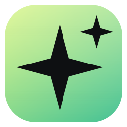
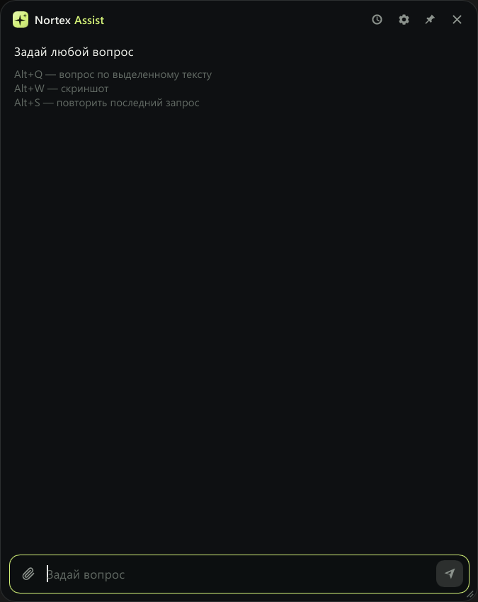
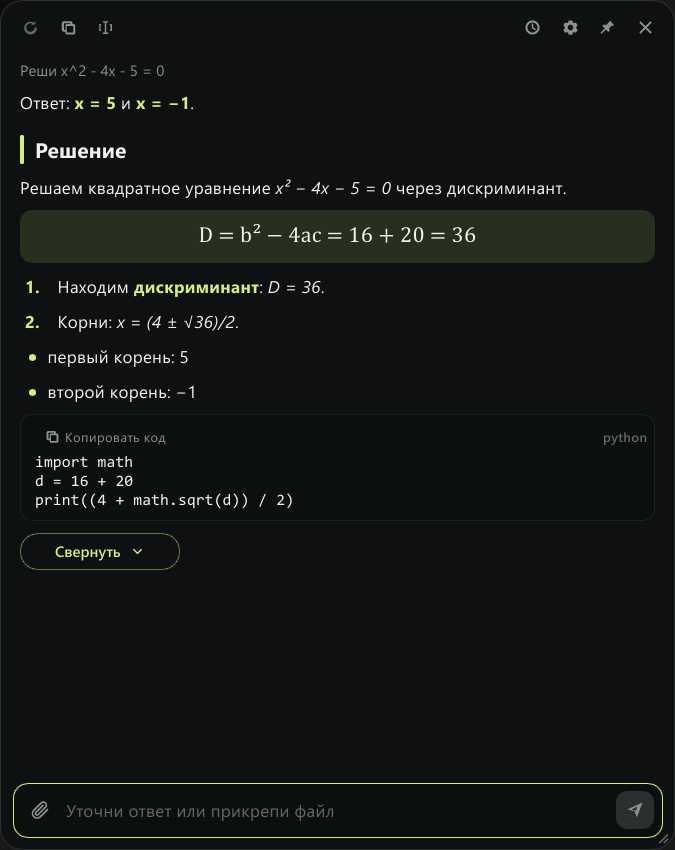
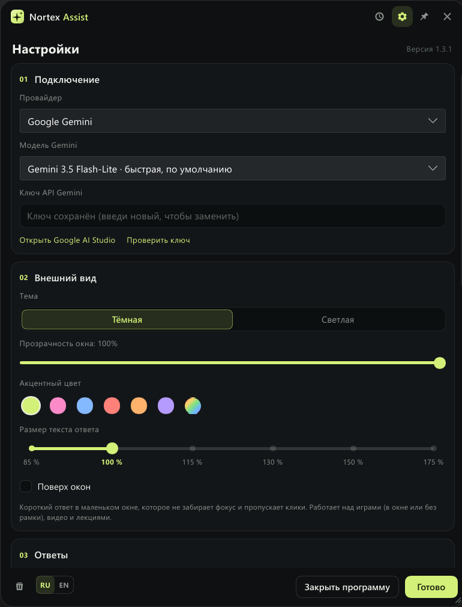
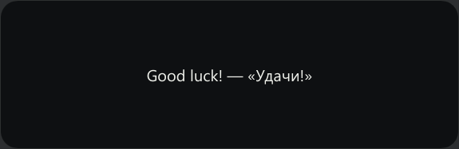

<p align="center">
  
</p>

<h1 align="center">Nortex Assist</h1>

<p align="center">
  AI-помощник по горячим клавишам для Windows: спросите Gemini или Groq<br>
  по выделенному тексту, скриншоту или просто своим вопросом.
</p>

<p align="center">
  <a href="https://github.com/nortex-labs/nortex-assist/releases/latest"></a>
  <a href="LICENSE"></a>
  
</p>

<p align="center">
  <b>Русский</b> · <a href="README.en.md">English</a>
</p>

<p align="center">
  
  &nbsp;
  
</p>

## Скачать

Все версии лежат на странице [Releases](https://github.com/nortex-labs/nortex-assist/releases).

- **`NortexAssist-Setup-X.Y.Z.exe`** — установщик. Рекомендуется: создаёт ярлык в меню «Пуск» и удаляется как обычная программа. Права администратора не нужны.
- **`nortex-assist.exe`** — портативная версия. Ничего не устанавливает, просто запустите.

Обе версии обновляются сами. Windows SmartScreen может предупредить о неизвестном издателе: нажмите «Подробнее» → «Выполнить в любом случае».

## Возможности

- **Вопрос по выделенному тексту.** Выделите текст в любой программе и нажмите Alt+Q. Буфер обмена потом восстанавливается.
- **Вопрос по скриншоту.** Alt+W: экран замирает, вы обводите нужную область мышью. До 4 снимков в одном вопросе, картинку можно вставить и через Ctrl+V.
- **Диалог.** Ответ можно уточнить следующим вопросом. История хранится зашифрованной, её можно открыть и продолжить.
- **Две нейросети на выбор.** Google Gemini (несколько моделей) или Groq (Qwen 3.8 27B). Обе дают бесплатный ключ.
- **Режим поверх игр.** Короткий ответ в маленьком окне, которое не забирает фокус у игры.
- **Под себя.** Стиль ответов (свой промпт и заготовки), тёмная и светлая тема, прозрачность, акцентный цвет, свои горячие клавиши.

## Быстрый старт

1. Скачайте и запустите установщик со страницы [Releases](https://github.com/nortex-labs/nortex-assist/releases).
2. Получите бесплатный ключ API. Нужен один из двух:
   - **Gemini:** откройте [Google AI Studio](https://aistudio.google.com/app/apikey), войдите в аккаунт Google, нажмите «Create API key», скопируйте ключ.
   - **Groq:** откройте [Groq Console](https://console.groq.com/keys), зарегистрируйтесь, нажмите «Create API Key», скопируйте ключ.
3. При первом запуске сами откроются настройки. Выберите провайдера, вставьте ключ в поле «Ключ API» и нажмите «Готово». Кнопка «Проверить ключ» покажет, работает ли он.
4. Выделите текст в любой программе и нажмите **Alt+Q**. Ответ появится в окне справа внизу.

## Горячие клавиши

Клавиши меняются в настройках, в разделе «Горячие клавиши».

| Клавиши | Что делает |
|---------|------------|
| **Alt+Q** | Вопрос по выделенному тексту |
| **Alt+W** | Скриншот. Способ выбирается в настройках: «Выделить область», «Весь экран» или «Ножницы Windows» |
| **Alt+E** | Свободный вопрос. Повторное нажатие начинает новый диалог |
| **Alt+S** | Повторить последний запрос, например после ошибки сети. Если ответ уже пришёл, модель попробует ответить иначе |

В окне программы:

- **Esc** прячет окно и останавливает ответ;
- **Ctrl+V** в поле ввода вставляет картинку из буфера обмена;
- **кнопка-булавка** закрепляет окно, чтобы оно не пряталось при клике в другое место.

<p align="center">
  
</p>

## Режим поверх игр

Включается в настройках: «Поведение» → «Режим поверх игр». После этого:

- Alt+W сразу снимает весь экран и отправляет снимок, без выделения области;
- короткий ответ появляется в маленьком окне. Окно не забирает фокус у игры и пропускает клики;
- окно исчезает через 20 секунд или по Alt+E;
- Alt+Q тоже отвечает в этом окне;
- окно подстраивается под длину ответа и открывается там, где находится левый верхний угол окна чата. Размер текста (от 12 до 32 px) выбирается там же, в настройках.

<p align="center">
  
</p>

> [!IMPORTANT]
> - Режим работает, только если игра запущена **в окне или в окне без рамки**. В полноэкранном режиме (exclusive fullscreen) Windows не показывает чужие окна поверх игры, а скриншот может получиться чёрным.
> - Античиты некоторых онлайн-игр реагируют на программы, которые рисуют поверх игры или снимают экран. Используйте режим на свой риск.

## Приватность и данные

- Ключи API, настройки и история хранятся **только на вашем компьютере**.
- Файлы шифруются AES-256-GCM. Ключ шифрования защищён Windows DPAPI, поэтому прочитать файлы можно только под вашей учётной записью Windows.
- Вопросы, текст и скриншоты отправляются **только выбранному провайдеру**: Google Gemini или Groq. Других серверов у программы нет.
- Программа обращается к GitHub, чтобы проверить обновления. Это можно отключить.
- Скриншоты не сохраняются на диск. В историю попадают только вопросы и ответы.

Где лежат файлы: `%APPDATA%\NortexAssist`

| Файл | Что внутри |
|------|-----------|
| `config.bin` | настройки и ключи API (зашифрованы) |
| `history.bin` | история, до 300 записей (зашифрована) |
| `master.bin` | ключ шифрования, защищённый DPAPI |
| `log.txt` | журнал ошибок (не больше 512 КБ) |

Историю можно отключить или очистить в настройках («Поведение»). При удалении программы установщик спросит, удалить ли эти файлы.

## Системные требования

- Windows 10 или 11, 64-бит.
- Интернет.
- Около 22 МБ на диске. Установщик весит около 9 МБ.
- Бесплатный ключ API Gemini или Groq.

## Вопросы и ответы

**Скриншот в игре получается чёрным.**
Переключите игру в оконный режим или в окно без рамки. В полноэкранном режиме Windows не всегда даёт снять экран.

**Пишет «Лимит Gemini» или «Лимит запросов Groq».**
У бесплатного ключа есть ограничение на число запросов в минуту и в день. Подождите минуту и нажмите Alt+S, чтобы повторить. Можно выбрать в настройках другую модель или другого провайдера.

**Где значок программы?**
В трее справа внизу, рядом с часами. Новые значки Windows прячет под стрелку «^». Перетащите значок на панель задач, чтобы он был виден всегда. Значок можно отключить в настройках («Отображать приложение в трее»). Тогда окно открывается по Alt+E.

**Как обновить программу?**
Ничего делать не нужно. Программа проверяет обновления через 10 секунд после запуска и потом раз в 12 часов. Когда выйдет новая версия, в окне появится полоса «Обновить»: программа скачает её, установит и перезапустится. Настройки и история сохранятся. Проверить вручную: «Настройки» → «Обновления» → «Проверить сейчас».

**Как отключить автообновление?**
«Настройки» → «Обновления» → снимите галочку «Проверять обновления автоматически».

**Как сменить горячие клавиши?**
«Настройки» → «Горячие клавиши». Нажмите на поле с клавишами и нажмите новое сочетание. Кнопка «По умолчанию» возвращает Alt+Q, Alt+W, Alt+E, Alt+S. Если сочетание занято другой программой, Nortex Assist предупредит.

**Как полностью закрыть программу?**
Правый клик по значку в трее → «Выход». Или «Настройки» → «Закрыть программу».

## Сборка из исходников

Нужны Rust (stable, MSVC) и Visual Studio Build Tools с компонентом «Разработка классических приложений на C++».

```powershell
git clone https://github.com/nortex-labs/nortex-assist.git
cd nortex-assist
cargo build --release   # готовый файл: target\release\nortex-assist.exe
```

Подробности о сборке, тестах и выпуске версий: [CONTRIBUTING.md](CONTRIBUTING.md).

## Лицензия

[MIT](LICENSE) © 2026 Nortex Labs
